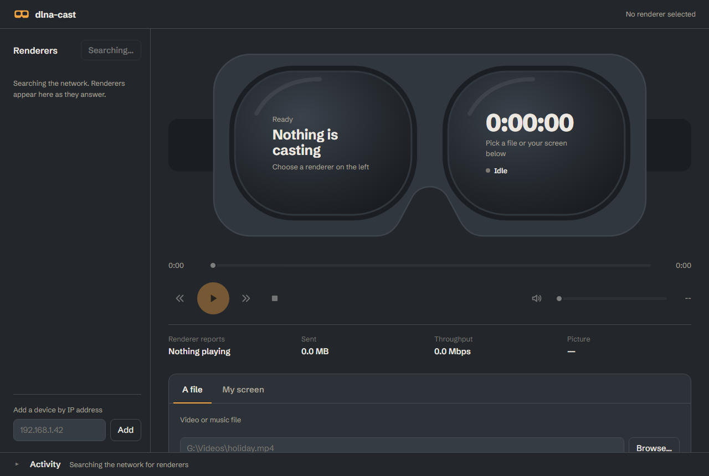

<div align="center">


# dlna-cast

**Cast videos, music or your live desktop to DLNA video goggles and smart TVs, from a desktop app or the command line.**

[](https://github.com/karan-ksrk/dlna-cast/actions/workflows/test.yml)
[](LICENSE)




</div>

dlna-cast talks to any DLNA/UPnP **MediaRenderer** on your local network (video goggles, smart TVs, set-top boxes, AV receivers) using only open standards: SSDP for discovery, HTTP for streaming, and SOAP for control. It is a single Node.js package with **no npm dependencies**. Screen casting uses [ffmpeg](https://ffmpeg.org/).

## Features

- **Finds renderers automatically.** It searches with SSDP `M-SEARCH` and also listens for the `NOTIFY` announcements some devices send instead of answering searches. It remembers the last device you used.
- **Cast a file** with byte-range seeking. The format is matched to what the renderer says it accepts (`GetProtocolInfo`).
- **Cast your screen live** as low-latency H.264 in MPEG-TS. It uses GPU capture (Desktop Duplication) and encoding (NVENC, Quick Sync or AMF) when available, and falls back to software automatically.
- **Includes the PC's sound** (WASAPI loopback) in screen casts, with no virtual audio driver needed.
- **Full remote control:** pause, resume, seek, volume and mute. Each command is checked against what the renderer reports, so devices that silently ignore a command are called out rather than trusted.
- **A desktop app** with a native file picker, recent files, display and quality choices, a live throughput readout, and an activity log. It also has a **command line** with keyboard controls.
- **Safe on your network:** media is served only to the renderer you chose, at an unguessable URL. The app's control API is bound to `127.0.0.1` and requires a per-launch token.

## Requirements

- **Node.js 18.17 or newer**
- **ffmpeg**, only for screen casting (`winget install Gyan.FFmpeg`, or put a portable build in a `.tools` folder next to the project)
- **Windows 10/11** for the desktop app, screen capture and system audio. File casting and remote control from the command line work on macOS and Linux too.
- A DLNA renderer on the same network as your PC

## Getting started

```sh
git clone https://github.com/karan-ksrk/dlna-cast.git
cd dlna-cast
npm test          # optional: runs the test suite against a simulated renderer
```

There is nothing to install with npm.

### Desktop app (Windows)

Create a desktop shortcut that opens the app with no console window:

```sh
powershell -ExecutionPolicy Bypass -File tools\install-shortcut.ps1          # add -StartMenu for a Start menu entry
```

Or run it directly:

```sh
npm run gui
```

The app opens in its own window. Pick a renderer on the left, then cast a file or your screen.

| Shortcut | Action |
| --- | --- |
| Space | Pause or resume |
| ← / → | Seek 10 seconds |
| ↑ / ↓ | Volume |
| M | Mute |

Closing the window stops casting and quits. Opening the shortcut while the app is running opens another window for it. When started from the shortcut, logs go to `%LOCALAPPDATA%\dlna-cast\app.log`.

### Command line

```sh
node src/cli.mjs discover                       # list renderers on the network
node src/cli.mjs play "D:\Videos\holiday.mp4"   # cast a file
node src/cli.mjs screen                         # cast your desktop, with the PC's sound
```

While `play` or `screen` is running: Space pause/resume, ←/→ seek 10 s, ↑/↓ volume, M mute, Q stop.

These commands control the renderer directly, so they also work from a second terminal:

```sh
node src/cli.mjs pause
node src/cli.mjs resume
node src/cli.mjs seek 1:30          # or 90, 0:01:30, +30, -10
node src/cli.mjs volume 40          # or +5 / -5; no number prints the volume
node src/cli.mjs mute               # or unmute
node src/cli.mjs status
node src/cli.mjs stop
```

To use `dlna-cast` as a command, run `npm link` once in the project folder.

## Choosing a renderer

You usually don't have to:

1. The last renderer you used is tried first.
2. Otherwise dlna-cast searches for up to 15 s and stops shortly after the first renderer answers.
3. If it finds one renderer, it uses it. If it finds several, it asks you to choose.

| Option | |
| --- | --- |
| `--device, -d <n\|name\|ip\|udn>` | Pick a renderer from the search results |
| `--rescan` | Ignore the remembered renderer and search again |
| `--ip <host[:port]>` | Talk to one device directly |
| `--location <url>` | Use a device's description URL and skip discovery |
| `--timeout <ms>` | How long to search |

## Screen casting options

| Option | Default | |
| --- | --- | --- |
| `--monitor <n>` | `0` | Display index (0 = main display) |
| `--fps <n>` | `30` | Frames per second |
| `--bitrate <kbps>` | `6000` | Video bitrate |
| `--max-height <px>` | `1080` | Downscale larger screens |
| `--encoder` | `auto` | `nvenc`, `qsv`, `amf`, `x264` or `openh264`; `auto` tests each and uses the first that works, GPU first |
| `--capture` | `auto` | `ddagrab` (GPU), `gdigrab` (whole desktop) or `testsrc` (a test pattern, useful for checking a device) |
| `--audio` | `system` | `system` (what the PC is playing), `none`, or a DirectShow input from `node src/cli.mjs audio-devices` |
| `--no-mouse` | | Hide the pointer |
| `--ffmpeg <path>` | | Path to ffmpeg; otherwise `DLNA_CAST_FFMPEG`, `PATH`, then a `.tools` folder |

## Compatibility

dlna-cast works with renderers that implement the standard UPnP AV `AVTransport` service. It has been tested with:

| Device | Discovery | Files | Screen | Pause/seek | Volume |
| --- | --- | --- | --- | --- | --- |
| Video goggles on the Platinum UPnP stack | NOTIFY only | MP4, MPEG-TS | ✅ | ✅ | Ignored by the device (reported) |

Tried it with another device? Please [open an issue](https://github.com/karan-ksrk/dlna-cast/issues) or a pull request to add it to this table.

## How it works

```
 discover            serve                           control
┌──────────┐   ┌─────────────────────────┐   ┌────────────────────────┐
│ SSDP     │   │ HTTP media server       │   │ SOAP over HTTP         │
│ M-SEARCH │──▶│ file: byte ranges       │◀──│ AVTransport: SetURI,   │
│ + NOTIFY │   │ live: ffmpeg MPEG-TS    │   │ Play, Pause, Seek      │
└──────────┘   │ fanned out per renderer │   │ RenderingControl:      │
               └─────────────────────────┘   │ volume, mute           │
                         ▲                   └────────────────────────┘
          ffmpeg ◀── screen (ddagrab/gdigrab) + system audio (WASAPI loopback)
```

1. **Discovery** ([`src/ssdp.mjs`](src/ssdp.mjs)) repeats `M-SEARCH` on every LAN interface while listening for `NOTIFY ssdp:alive`. A device's description and control URLs are only used when they're on a local address and on the same host that answered.
2. **Serving** ([`src/media-server.mjs`](src/media-server.mjs)): a file is served with `206`/`416` range support. A live stream is cut into whole 188-byte TS packets ([`src/live-broadcast.mjs`](src/live-broadcast.mjs)), so a renderer that joins mid-stream or falls behind always gets packets it can sync on.
3. **Control** ([`src/soap.mjs`](src/soap.mjs), [`src/session.mjs`](src/session.mjs)): `SetAVTransportURI` with DIDL-Lite metadata, then `Play`. The renderer's state is polled every second, and each pause, volume or mute change is read back to confirm it took effect.
4. **Screen** ([`src/screen-stream.mjs`](src/screen-stream.mjs), [`src/ffmpeg.mjs`](src/ffmpeg.mjs)): ffmpeg captures the display and encodes low-latency H.264 with a keyframe every second. System audio comes from a small WASAPI loopback helper ([`src/wasapi-loopback.ps1`](src/wasapi-loopback.ps1)) that pipes PCM into ffmpeg and fills silence so the stream never stalls.
5. **App** ([`src/gui/`](src/gui)): a loopback HTTP server with a JSON API and Server-Sent Events, opened in an Edge or Chrome app-mode window.

## Troubleshooting

| Symptom | Try |
| --- | --- |
| No renderers found | Make sure the device and PC are on the same network and the device is on. Some devices only announce themselves every few seconds; search for longer with `--timeout 30000`. |
| Windows Firewall prompt on first cast | Allow Node.js on private networks. The renderer has to connect back to your PC to fetch the media. |
| `UPnP 714` / "unsupported media format" | The renderer can't play that container or codec. Convert the file, or cast it as a screen stream. |
| Volume or mute "accepted but didn't change" | The renderer ignores remote volume. Use its own buttons. |
| Screen cast stutters | Pick the Light quality preset or `--bitrate 3000`, and move closer to the Wi-Fi router. |
| The app window doesn't open | Check `%LOCALAPPDATA%\dlna-cast\app.log`. |

## Development

```sh
npm test
```

The tests run against a loopback fake renderer ([`fixtures/fake-renderer.mjs`](fixtures/fake-renderer.mjs)). It can answer searches or only send NOTIFY, includes hostile URLs in its description that must be rejected, and can ignore Pause or volume the way real devices do. The screen-casting test runs real ffmpeg with a test pattern and is skipped when ffmpeg isn't installed.

```
src/
  cli.mjs             command line
  session.mjs         a cast in progress: polling and controls
  cast.mjs            start a file or screen cast
  ssdp.mjs            discovery          description.mjs  device descriptions
  soap.mjs            AVTransport and RenderingControl
  media-server.mjs    file and live HTTP serving
  ffmpeg.mjs          encoder detection and screen arguments
  gui/                desktop app (server + page)
tools/                icon builder and shortcut installer
test/  fixtures/      tests and the fake renderer
```

## Contributing

Contributions are welcome, especially reports from devices that aren't in the compatibility table. See [CONTRIBUTING.md](CONTRIBUTING.md).

## License

[MIT](LICENSE) © Karan ([karan-ksrk](https://github.com/karan-ksrk))

dlna-cast doesn't include ffmpeg; ffmpeg is licensed separately under the LGPL/GPL.
